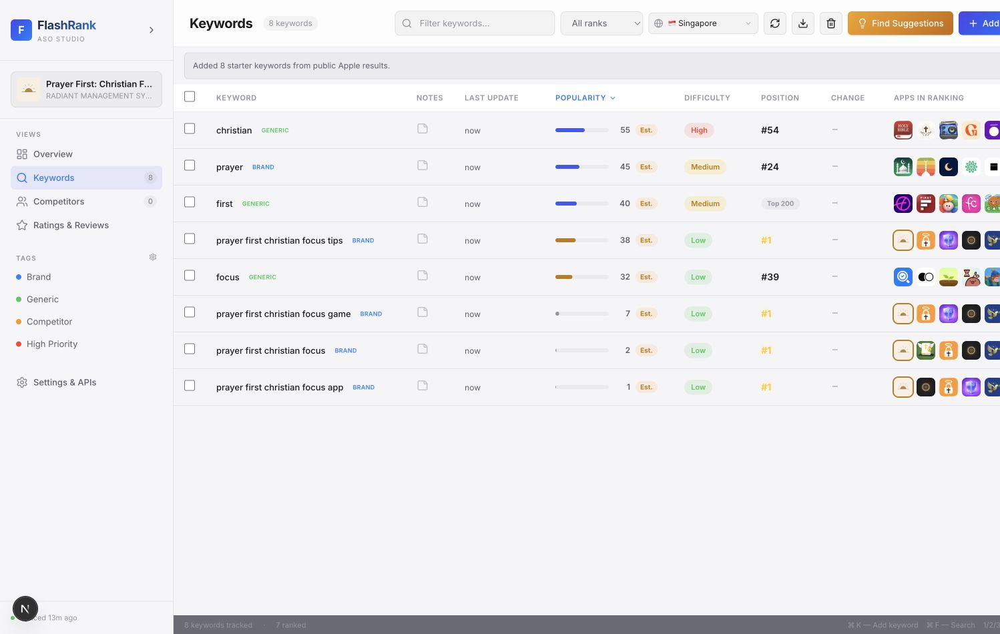
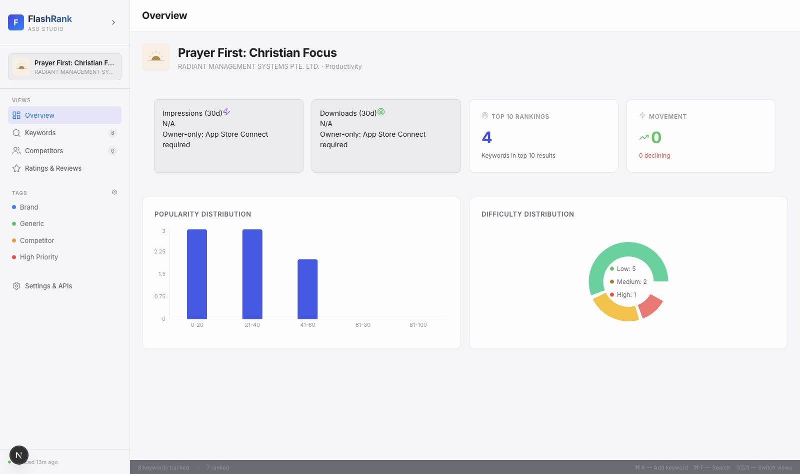
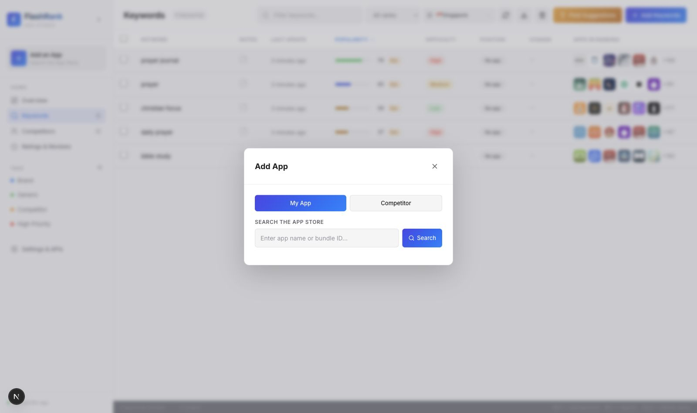
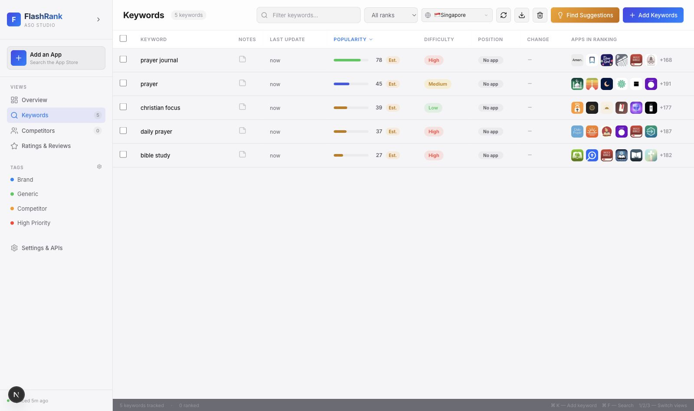
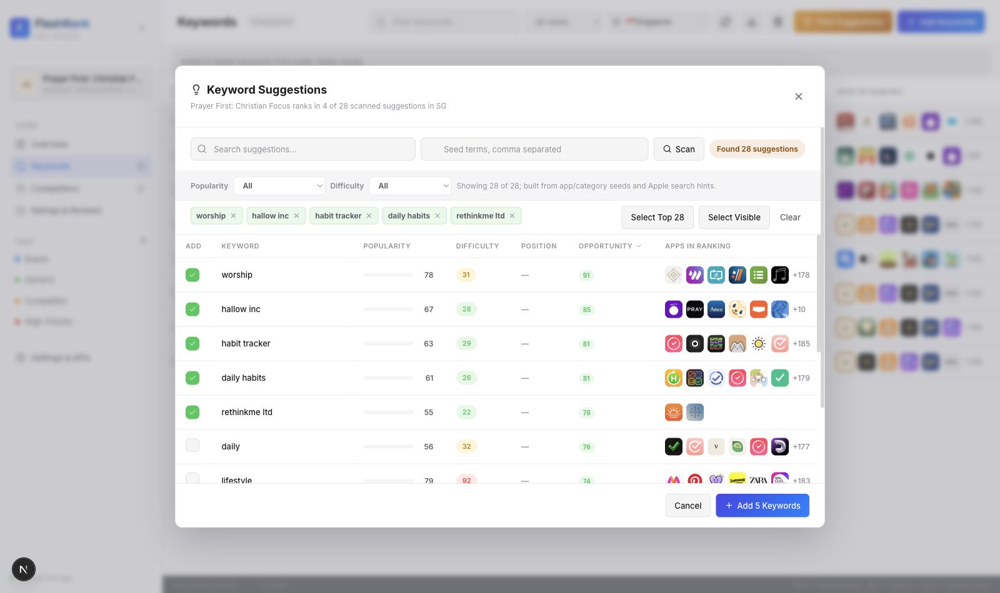
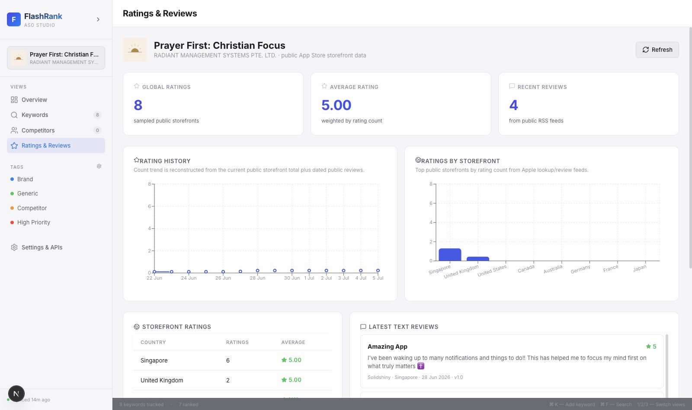
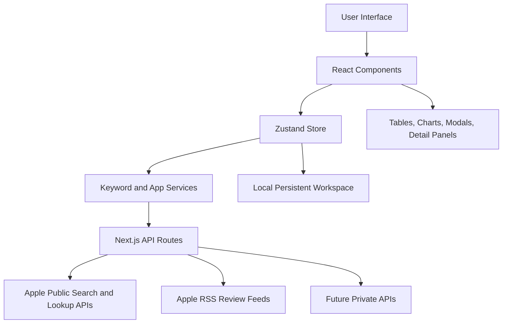

# Building FlashRank: A Practical ASO Intelligence Tool for App Store Keyword Research

> Draft status: first written draft. Screenshots should be added after content review.

## Table of Contents

- [Executive Summary](#executive-summary)
- [The Problem FlashRank Solves](#the-problem-flashrank-solves)
- [TLDR: What FlashRank Offers](#tldr-what-flashrank-offers)
- [Who FlashRank Is For](#who-flashrank-is-for)
- [ASO Concepts for Beginners](#aso-concepts-for-beginners)
- [Product Goals](#product-goals)
- [Feature Overview](#feature-overview)
- [System Architecture](#system-architecture)
- [Key Engineering Decisions](#key-engineering-decisions)
- [Data Sources and Limitations](#data-sources-and-limitations)
- [User Workflow](#user-workflow)
- [Testing and Quality Approach](#testing-and-quality-approach)
- [Security and API Key Strategy](#security-and-api-key-strategy)
- [Production Roadmap](#production-roadmap)
- [Packaging Options](#packaging-options)
- [What This Project Demonstrates](#what-this-project-demonstrates)
- [Lessons Learned](#lessons-learned)
- [Conclusion](#conclusion)
- [Screenshot Plan](#screenshot-plan)

<div class="page-break"></div>

## Executive Summary

FlashRank is a desktop-style App Store Optimization, or ASO, studio for iOS app developers, indie founders, marketers, and product teams who want to understand how their apps appear in App Store search.

The app helps users search for an app, add tracked keywords, inspect public keyword rankings by country, compare competitor visibility, generate keyword ideas, and review public ratings/review signals. The product is designed around a simple idea: ASO work is mostly comparison work. Users need to compare keywords, countries, ranking positions, competitors, and historical movement quickly, without jumping between disconnected tools.

FlashRank was built as a web app using Next.js, React, TypeScript, Zustand, and server-side API routes. The current build prioritizes free and public App Store data first, while keeping the infrastructure ready for private Apple integrations such as App Store Connect, Apple Search Ads, DeepL, and future billing.

The most important engineering choice in FlashRank is honesty about data. Apple does not expose every ASO or business metric publicly. Metrics such as downloads, impressions, product page views, conversion rate, revenue, exact keyword search volume, and real Apple Search Ads popularity require authenticated APIs and account permissions. FlashRank therefore separates public ranking intelligence from private metrics, labels estimated values clearly, and avoids pretending that unavailable data is exact.



## The Problem FlashRank Solves

When users search in the App Store, Apple returns a ranked list of apps. For developers, those search results matter because a high-ranking app is more likely to be discovered and downloaded.

However, App Store keyword research is difficult for several reasons:

- Rankings vary by country and storefront.
- A keyword can be popular but too competitive to rank for.
- A lower-volume keyword can still be valuable if an app can realistically rank near the top.
- Competitors may reveal keyword opportunities that are not obvious from the app name alone.
- Public App Store pages do not show a developer all the useful ASO data in one place.
- Private metrics require Apple credentials and permissions, which many prototypes or free tools cannot assume.

FlashRank tackles the public side of this problem. It lets users inspect what Apple publicly returns for keyword searches, track where their app appears, compare competitor positions, and build better keyword lists from observable ranking behavior.

## TLDR: What FlashRank Offers

### Features Offered

| Feature area | What users get |
| --- | --- |
| App tracking | Search by app name or App Store URL, add a primary app, and manage competitor apps. |
| Keyword intelligence | Track keywords by country, view popularity, difficulty, rank position, ranking apps, movement, notes, and tags. |
| Keyword suggestions | Generate relevant keyword ideas from app metadata, public search hints, and competitor ranking scans. |
| Competitor analysis | Compare the user's app against competitors for the same keywords and extract observed competitor opportunities. |
| Ratings and reviews | View public storefront rating counts, average ratings, review snippets, and reputation trends. |
| Region-aware research | Switch App Store regions without wiping keyword work, because rankings differ by storefront. |
| Import and export | Add keywords manually or from text/JSON lists, then export workspace data for reporting. |
| Key-ready settings | Prepare for App Store Connect, Apple Search Ads, DeepL, and future paid integrations without exposing private keys in frontend code. |

### Technology Integrated

| Technology | Why it is used |
| --- | --- |
| Next.js | Provides the React app shell, routing, server-side API routes, and a clean deployment path. |
| React | Powers the interactive ASO workspace: tables, modals, charts, sidebars, and detail panels. |
| TypeScript | Keeps app, keyword, ranking, competitor, and API data models explicit and safer to evolve. |
| Zustand | Centralizes app state with less boilerplate than Redux for this prototype stage. |
| Apple iTunes Search/Lookup APIs | Supplies public App Store app search, metadata lookup, and keyword result scanning. |
| Apple Search Hints | Supplies public keyword suggestion signals where available. |
| Recharts | Renders ranking, distribution, and ratings charts. |
| Server API routes | Keep external requests and future private integrations behind a backend boundary. |
| Local persistence | Stores the user's current workspace locally for a fast prototype experience. |
| Environment-based credentials | Prepares server-side key handling for Apple, DeepL, and future billing integrations. |

### Future Plans

| Roadmap area | Planned direction |
| --- | --- |
| Cloud accounts | Add authentication, user workspaces, and team access. |
| Database persistence | Move from browser-local state to durable cloud storage. |
| Historical tracking | Store long-term keyword snapshots and competitor movement. |
| Private Apple integrations | Add signed App Store Connect and Apple Search Ads connectors for owner-grade metrics. |
| Translation | Use DeepL to translate foreign-language keywords and reviews. |
| Background jobs | Queue ranking refreshes, handle rate limits, and cache expensive scans. |
| Billing | Add Lemon Squeezy or similar licensing if premium tiers are introduced. |
| Packaging | Offer PWA or desktop packaging after the hosted backend is stable. |

<div class="page-break"></div>

## Who FlashRank Is For

FlashRank is aimed at:

- Indie iOS developers validating keyword opportunities before changing metadata.
- App marketers comparing competitors across storefronts.
- Founders who need a clearer view of how their app is discovered.
- Product teams who want lightweight ASO research without immediately paying for a full enterprise ASO platform.
- Interviewers or technical reviewers who want to see how a realistic product handles third-party data limits, state management, and user-facing tradeoffs.

## ASO Concepts for Beginners

ASO stands for App Store Optimization. It is the practice of improving how an app appears in App Store search and browse surfaces.

The core concepts in FlashRank are:

| Concept | Meaning |
| --- | --- |
| Keyword | A word or phrase users might search in the App Store. |
| Popularity | How much search demand a keyword appears to have. In the current free build, this is estimated unless a real Apple Search Ads source is connected. |
| Difficulty | How hard it may be to rank highly for a keyword, based on signals such as popularity and the strength of top-ranking apps. |
| Position | Where the selected app appears in public App Store search results for a keyword. |
| Apps in Ranking | The apps Apple returns for that keyword, including visible top apps and the total number scanned or returned. |
| Region | The App Store country storefront, such as Singapore or United States. Rankings can differ by region. |
| Competitor | Another app tracked beside the user's app to compare keyword visibility. |

For example, if a farming game ranks #3 for "farm game" in Singapore but does not appear for "cozy farming simulator" in the top public results, the user learns two different things: one keyword is already working, while the other may require metadata changes, content changes, or may simply be too competitive.

## Product Goals

FlashRank was built around six product goals:

1. Make keyword research fast and visual.
2. Keep the interface dense enough for serious ASO work.
3. Support country-specific keyword tracking.
4. Show users what is public data, estimated data, and private key-required data.
5. Help users discover competitor-driven keyword opportunities.
6. Leave a clean path toward a production SaaS architecture later.

The app is intentionally closer to a professional ASO dashboard than a marketing landing page. ASO workflows involve repeated scanning, sorting, filtering, and comparison. Because of that, FlashRank uses tables, sidebars, modals, chips, charts, and status labels rather than oversized promotional sections.

## Feature Overview

<div class="page-break"></div>



### Add App

Users can search for an App Store app by name or paste an App Store URL. FlashRank uses the public Apple iTunes Search and Lookup endpoints through local API routes to find app metadata such as:

- App name
- Developer
- Icon
- Category
- Rating
- Rating count
- Bundle ID
- App Store URL

Once an app is added, FlashRank can hydrate starter keyword ideas from the app name, category, metadata, and public App Store search behavior.



### Keyword Tracking

The keyword table is the main workspace. Users can add keywords manually, import lists, filter keywords, sort by popularity or difficulty, refresh ranking data, and inspect position changes.

Each tracked keyword stores:

- Keyword text
- Region
- Popularity score
- Difficulty label and score
- Current rank
- Previous rank
- Rank change
- Ranking apps
- Competitor ranks
- Notes
- Tags
- Rank history
- Data-source labels

The table is designed for scanning. A user can quickly see which keywords are promising, which are too competitive, where their app ranks, and where competitors are stronger.



### Keyword Suggestions

FlashRank generates keyword suggestions from several sources:

- Public Apple search hints.
- App name and metadata-derived seed terms.
- Category-related terms.
- Existing tracked keywords.
- Competitor ranking scans.
- Deterministic scoring for estimated popularity and difficulty.

This makes suggestions more relevant than simply returning a generic list of popular App Store terms. If the selected app is a Christian prayer app, suggestions should lean toward terms related to prayer, faith, devotion, Bible study, meditation, habits, reminders, or similar app metadata, not unrelated categories like puzzle games.

The keyword suggestion modal can also show how many candidate keywords the app appears to rank for in a specific region.



### Competitor Analysis

Users can add competitor apps and compare rankings side by side. FlashRank does not claim to extract a magical private list of every keyword a competitor ranks for, because Apple does not provide such a public endpoint.

Instead, FlashRank uses a public-search strategy:

1. Generate candidate keyword terms.
2. Query public App Store search results for each term.
3. Check whether the competitor appears in those results.
4. Add observed keywords where the competitor is visible.
5. Compare the user's app position against competitor positions.

This approach is transparent. It provides useful competitor intelligence without pretending to access private Apple data.

<!-- Screenshot placeholder: competitor comparison view -->

### Ratings and Reviews

FlashRank includes a Ratings & Reviews view that aggregates public storefront rating data and public review feeds where available. This gives users a lightweight view of app reputation across countries.

The current public implementation can show:

- Country-level rating counts.
- Average ratings.
- Public review snippets from Apple RSS feeds.
- Basic trend charts built from available and reconstructed public samples.

Owner-grade review workflows and full private analytics still require App Store Connect permissions.



### Region Switching

App Store rankings differ by storefront. A keyword that works in the United States may not work in Singapore, Japan, Brazil, or Saudi Arabia.

FlashRank stores keywords with region awareness so users can switch regions without destroying their keyword set. This matters because ASO is not global by default. Every country can have different competitors, language patterns, search behavior, and ranking outcomes.

### Keyword-Only Research Mode

FlashRank also supports keyword research without selecting an app. In that mode, users can inspect keyword popularity, difficulty, and public ranking apps even before tracking a specific app.

When no app is selected, the position column cannot show an app rank. Instead, FlashRank displays a clear no-app status rather than leaving the user guessing.

### Settings and API Keys

The Settings and API Keys area prepares the app for future private integrations:

- App Store Connect API
- Apple Search Ads API
- DeepL translation
- Future licensing or billing integrations

The important security principle is that private keys should not be placed directly in frontend code. The app is structured so credentials can be read by server-side routes and reported to the browser only as safe status information.

## System Architecture

FlashRank is organized as a Next.js application with client-side UI components, a Zustand store, typed domain models, and API routes that proxy external data sources.



### Frontend

The frontend is built with React and TypeScript inside Next.js. The UI is componentized by workflow:

| Area | Main responsibility |
| --- | --- |
| `Sidebar.tsx` | App selection, navigation, tag overview, settings access. |
| `HeaderBar.tsx` | Search, region controls, refresh, export, suggestion actions. |
| `KeywordTable.tsx` | Main keyword workspace with sorting, filtering, rank status, and apps-in-ranking display. |
| `AddAppModal.tsx` | App search, App Store URL lookup, competitor/app selection, app removal. |
| `AddKeywordModal.tsx` | Manual keyword entry, list import, JSON import, tag assignment. |
| `KeywordResearchModal.tsx` | Keyword suggestions, scanned candidates, popularity/difficulty filters. |
| `CompetitorsView.tsx` | Competitor keyword extraction and side-by-side comparison. |
| `RatingsReviewsView.tsx` | Public ratings, review snippets, and charts. |
| `DetailPanel.tsx` | Keyword-level detail, ranking apps, and rank history. |

This component split keeps product workflows visible in the file structure.

### State Management

FlashRank uses Zustand for app state. Zustand was chosen over Redux because the project needed a fast, understandable, local-first state model without excessive boilerplate.

The store keeps one main source of truth for:

- Apps
- Selected app
- Selected region
- Keywords
- Tags
- Filters
- Sort state
- Modals
- Sync progress
- API key form state

This makes it easier to keep table state, detail panels, modals, and region switching in sync.

### Data Model

The core domain types live in `src/types/index.ts`. Important models include:

- `AppMetadata`
- `TrackedApp`
- `TrackedKeyword`
- `RankingAppSnapshot`
- `RankHistoryEntry`
- `KeywordTag`
- `RankStatus`
- `ASODataSource`

The data model explicitly tracks data sources such as `estimated`, `itunes-search`, `apple-search-ads`, and `app-store-connect`. That is important because it lets the UI distinguish between estimated values and API-backed values.

### API Routes

FlashRank uses Next.js API routes as a proxy layer between the browser and external services.

| Route | Purpose |
| --- | --- |
| `/api/search` | Search public App Store apps. |
| `/api/lookup` | Look up a specific App Store app by ID. |
| `/api/suggestions` | Fetch public keyword search hints. |
| `/api/reviews` | Load public review feed data. |
| `/api/translate` | Prepare DeepL translation through a server-side key. |
| `/api/searchAds` | Placeholder for Apple Search Ads integration. |
| `/api/appStoreConnect` | Placeholder for App Store Connect integration. |
| `/api/credentials/status` | Report whether required server-side credentials are configured. |

This route layer is useful because it keeps browser code simpler and creates a natural place for future authentication, caching, rate limiting, and credential security.

### Ranking and Keyword Hydration

The keyword hydration layer is responsible for turning a keyword into useful ASO data.

At a high level:

1. A keyword is selected or added.
2. FlashRank searches the public App Store result set for that keyword and region.
3. It checks whether the selected app appears in the returned results.
4. It records the app's current position if found.
5. It stores the visible ranking apps.
6. It checks competitor positions in the same result set.
7. It updates difficulty signals based on the strength of top-ranking apps.
8. It updates rank history without wiping previous valid data when a refresh fails.

The current public ranking scan limit is designed to be useful while staying realistic about rate limits and response size.

### Persistence

The current app is local-first. Workspace state is persisted in the browser so users can continue where they left off on the same device and browser.

This is a good prototype choice because it allows fast iteration without requiring user accounts, a database, or cloud infrastructure.

For a production SaaS version, the next persistence layer would likely include:

- Authentication
- PostgreSQL or another hosted database
- Per-user workspace records
- Encrypted credential storage
- Background refresh jobs
- Historical rank snapshots
- Exportable reports

## Key Engineering Decisions

### Why Next.js

Next.js was chosen because FlashRank needs both a rich frontend and server-side routes. A plain React app could handle the UI, but it would still need a separate backend for Apple API proxying, credential handling, review fetching, and future private integrations.

Next.js gives the project:

- React UI composition.
- File-based app structure.
- Server-side API routes.
- A clean deployment path.
- A future path for authentication and database-backed features.

### Why TypeScript

TypeScript helps keep the ASO domain model explicit. Keyword records have many fields: popularity, difficulty, rank, history, region, tags, notes, competitor ranks, and data-source labels. TypeScript reduces the chance of mixing these up as the product grows.

It also makes the code easier to discuss in interviews because the types document the product model.

### Why Zustand Instead of Redux

Redux is powerful, but FlashRank does not need the amount of ceremony Redux introduces. Zustand gives the app:

- A small API.
- Direct store actions.
- Persistence middleware.
- Easy derived data.
- Less boilerplate for modal and table state.

For this project stage, Zustand is the better tradeoff because the state is complex enough to centralize but not so distributed that Redux is necessary.

### Why Public Apple Data First

The product can be useful before private API integrations exist. Public Apple endpoints allow users to:

- Search apps.
- Look up app metadata.
- Inspect public keyword search results.
- Compare visible ranking positions.
- Pull public review feeds.

Starting with public data makes the app testable immediately. It also forces the product to be honest about what is observable versus private.

### Why Estimated Popularity

Exact App Store keyword search volume is not freely public. Apple Search Ads can expose search popularity through authenticated access, but that requires account setup and signed API requests.

FlashRank currently uses deterministic estimated popularity so the UI can support sorting, filtering, and prioritization while clearly labeling the value as estimated. This lets the workflow exist before the paid/private data connector is complete.

The key is not that the estimate is perfect. The key is that the app does not present it as exact Apple data.

### Why Difficulty Uses Competition Signals

Difficulty is intended to answer a practical question: "How hard might it be to rank near the top for this keyword?"

A reasonable public approximation is to inspect the apps already ranking for a keyword. If top-ranking apps have large rating counts and strong public signals, the keyword is probably harder to compete for.

FlashRank combines keyword popularity with top-result competition signals to produce a difficulty score and label.

### Why Region-Aware Keywords

App Store ranking is local to the storefront. A keyword in Singapore can produce different apps than the same keyword in the United States.

For that reason, region is part of the keyword identity. This prevents a user's Singapore keyword data from being accidentally overwritten by a United States refresh.

### Why Local-First Persistence

Local-first persistence was chosen for speed and simplicity. It lets users test the product without accounts and lets the project focus first on ASO workflows.

The tradeoff is that localStorage is per browser/device. A production version would need cloud storage and authentication.

### Why Desktop-Style UI

FlashRank is a work tool, not a landing page. The user needs to scan dense information: keywords, ranks, competitors, difficulty, popularity, regions, and changes.

That led to a desktop-style interface with:

- Sidebar navigation.
- Dense tables.
- Toolbar actions.
- Modal workflows.
- Inline chips.
- Status labels.
- Detail panels.
- Charts for trends.

This design fits the task better than a decorative card-heavy marketing layout.

## Data Sources and Limitations

FlashRank separates data into three categories:

| Category | Examples | Current handling |
| --- | --- | --- |
| Public Apple data | App search, app lookup, public search results, public reviews | Implemented through API routes. |
| Estimated data | Popularity and some difficulty signals | Clearly labeled as estimated. |
| Private Apple data | Downloads, impressions, product page views, conversion, revenue, exact Search Ads popularity | Requires credentials and signed integrations. |

This distinction is important. It protects users from misunderstanding the numbers and protects the product from making claims it cannot support.

### Why Position Can Be Empty

If a keyword has no app position, it usually means one of these things:

- No app is selected, so there is nothing to rank.
- The selected app did not appear in the public search results checked.
- Apple returned no public results for that keyword and region.
- The refresh failed, and FlashRank preserved the previous valid state rather than overwriting it with fake data.

FlashRank uses rank statuses such as ranked, unranked, pending, error, and no-app to make these cases clearer.

### What FlashRank Does Not Fake

FlashRank does not fake:

- Real downloads.
- Real impressions.
- Real conversion rate.
- Real revenue.
- Real retention.
- Exact App Store search volume.
- Exact Apple Search Ads popularity without credentials.
- A complete private list of every keyword a competitor ranks for.

Instead, it shows what can be inferred from public search behavior and leaves private metrics behind key-required states.

## User Workflow

### Workflow 1: Track an App

1. Open the Add App modal.
2. Search for an app name or paste an App Store URL.
3. Select the app.
4. Let FlashRank hydrate starter keyword ideas.
5. Review the keyword table.
6. Refresh rankings by region.
7. Add tags and notes to important keywords.

### Workflow 2: Add Keywords

1. Click Add Keywords.
2. Type keywords separated by commas or new lines.
3. Optionally import a text or JSON list.
4. Assign tags such as Brand, Generic, Competitor, or High Priority.
5. Add selected keywords to the workspace.

### Workflow 3: Find Suggestions

1. Open Find Suggestions.
2. Review generated keyword ideas.
3. Filter by popularity or difficulty.
4. Select relevant suggestions.
5. Add them to the tracked keyword table.
6. Refresh ranking positions.

### Workflow 4: Compare Competitors

1. Add competitor apps.
2. Open the competitor view.
3. Scan competitor keyword opportunities.
4. Add observed competitor keywords.
5. Compare user app rank against competitor rank.
6. Prioritize keywords where competitors rank and the user's app does not.

### Workflow 5: Review Ratings

1. Open Ratings & Reviews.
2. Select a region or inspect global storefront samples.
3. Compare rating count and average rating.
4. Review public text reviews where available.
5. Use reputation signals to support ASO decisions.

## Testing and Quality Approach

The UAT plan groups quality checks around the product's main risk areas.

### Keyword Intelligence

FlashRank verifies that:

- Popularity and difficulty appear for new keywords.
- Rank history grows as keywords are refreshed.
- Suggestions are generated from app metadata and public search signals.
- Translation routes show key-required behavior when DeepL is not configured.

### Competitor Analysis

FlashRank verifies that:

- Competitor keyword extraction uses public ranking scans.
- Competitor ranks display beside the user's app rank.
- The app does not claim full private competitor visibility.

### Ratings and Reviews

FlashRank verifies that:

- Public storefront rating data can be aggregated.
- Review feeds can be fetched where Apple exposes them.
- Missing data is handled with clear empty states.

### Edge Cases

Important edge cases include:

- API rate limiting.
- Network loss.
- Obscure storefronts.
- Empty search results.
- Region switching.
- Refresh failures.
- No selected app.

The app is designed to preserve previous useful data when a refresh fails instead of blanking the UI.

## Security and API Key Strategy

FlashRank prepares for API keys but avoids putting private secrets directly in browser code.

Future production handling should include:

- Server-side environment variables for app-level integrations.
- Encrypted per-user credential storage for user-owned Apple accounts.
- Least-privilege Apple API keys.
- Backend validation of credential completeness.
- Redacted status responses to the browser.
- No private key values in client logs or localStorage.

For App Store Connect, a user would need:

- Issuer ID.
- Key ID.
- `.p8` private key.
- Correct app/account permissions.

For Apple Search Ads, a user would need:

- Client ID.
- Team ID.
- Key ID.
- Private key.
- API access enabled for the account.

For DeepL, a user would need:

- DeepL auth key.

## Production Roadmap

FlashRank's current architecture is a strong prototype foundation. To become a production SaaS, the next major pieces would be:

- User authentication.
- Cloud database storage.
- Per-user workspaces.
- Encrypted API key vault.
- Background keyword refresh queue.
- API rate-limit handling.
- Server-side caching.
- Historical ranking snapshots.
- Team collaboration.
- Billing and licensing.
- Exportable PDF/CSV reports.
- Monitoring and error reporting.
- PWA or desktop packaging.

## Packaging Options

FlashRank can remain a web app, but it can also be packaged for easier distribution.

| Option | Best for | Tradeoff |
| --- | --- | --- |
| PWA | Fastest installable version from the browser | Still feels browser-based. |
| Tauri | Lightweight desktop app for Mac/Windows | Requires desktop packaging setup. |
| Electron | Broad desktop compatibility | Larger app size and heavier runtime. |

Even if FlashRank is packaged as a desktop app, the best production architecture would still keep sensitive API work on a hosted backend. That keeps credentials, caching, and rate limits under control.

## What This Project Demonstrates

FlashRank demonstrates:

- Product thinking around ASO workflows.
- Practical use of public Apple data.
- Honest handling of third-party API limitations.
- React component architecture.
- TypeScript domain modeling.
- Zustand state management.
- Next.js API route design.
- Responsive, data-dense UI design.
- Region-aware data modeling.
- Competitor comparison logic.
- Credential-ready infrastructure.
- User-facing empty, error, and key-required states.

For interviewers, the important story is not just that the app has tables and charts. The important story is that the system makes deliberate tradeoffs: public data first, estimated values labeled clearly, private metrics blocked until credentials exist, and a path toward production infrastructure.

## Lessons Learned

Building FlashRank revealed several practical lessons:

1. Data-source honesty matters more than feature count.
2. ASO ranking data is region-specific, so region must be part of the model.
3. Competitor intelligence should be framed as observed public behavior, not secret private access.
4. Dense productivity tools need layouts optimized for scanning.
5. A local-first prototype can move quickly, but production requires cloud persistence and auth.
6. API-key infrastructure should be planned early so private integrations can be added without rewriting the product.
7. Good empty and error states are part of the feature, especially when external APIs are involved.

## Conclusion

FlashRank is a practical ASO intelligence tool built to help users understand keyword visibility, ranking opportunities, competitor movement, and public App Store reputation signals.

The project combines product design, frontend engineering, API integration, data modeling, and honest external-data handling. It is useful as a working ASO prototype today, and its architecture leaves room for more advanced SaaS features later.

For beginners, FlashRank shows how App Store keyword research works in plain terms. For users, it explains what they can do inside the app. For technical reviewers and interviewers, it shows the reasoning behind the stack, state model, data-source boundaries, and product tradeoffs.

## Screenshot Plan

Add screenshots after this draft is approved:

- Main keyword table with popularity, difficulty, position, and apps in ranking.
- Add App modal.
- Add Keywords modal with import/list support.
- Keyword Suggestions modal.
- Competitor comparison view.
- Ratings & Reviews view.
- Settings/API key status view.

Store final images in:

```text
docs/assets/
```

Then embed them in this report using relative Markdown paths.
